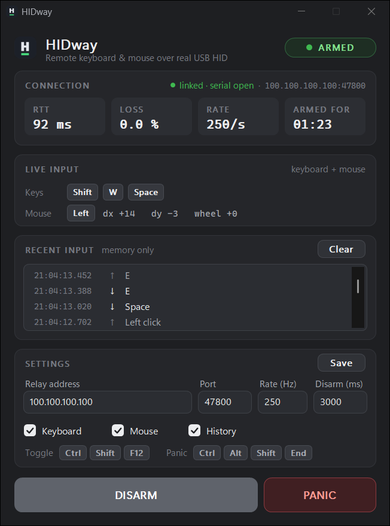
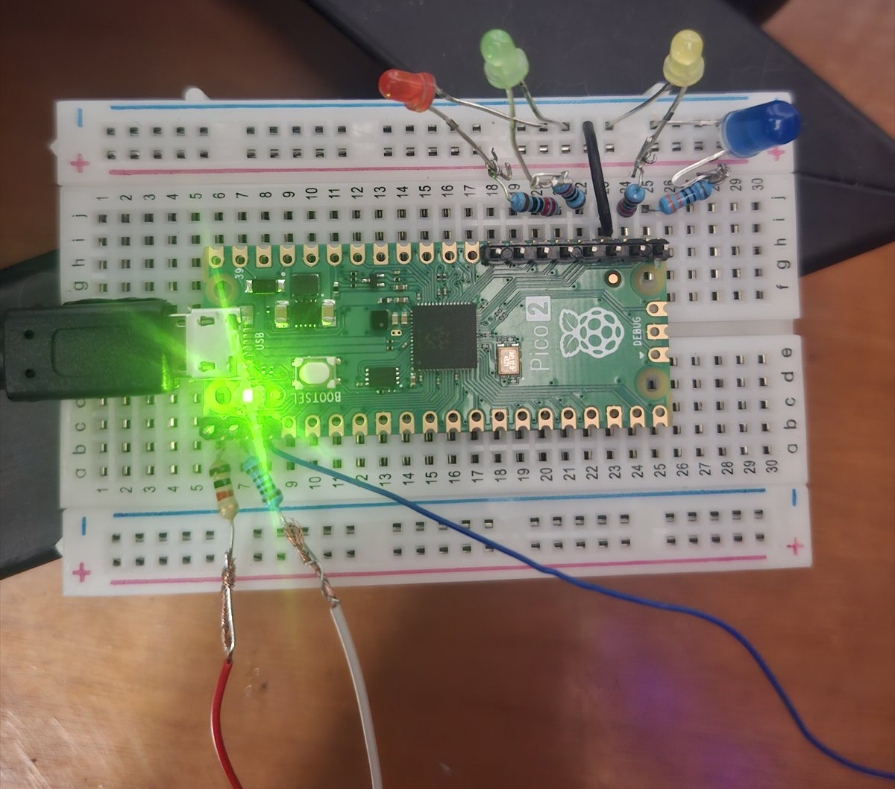
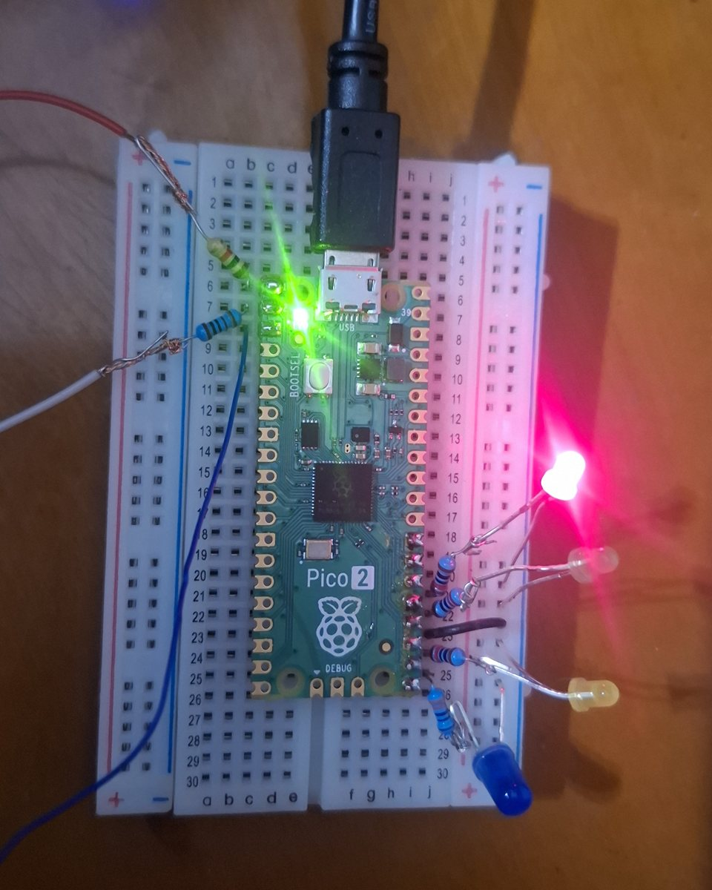

# HIDway

[](https://github.com/wannabexaker/HIDway/actions/workflows/ci.yml)

**Remote physical keyboard & mouse over a real USB HID interface.**

HIDway lets you control a computer from another PC across the network, where
the target machine sees nothing but an ordinary USB keyboard and mouse. A
Raspberry Pi Pico acts as a genuine USB HID device; a small relay on a
Raspberry Pi forwards input to it over an encrypted link. It is, in effect, a
build‑it‑yourself networked KVM for keyboard and mouse.

```
┌──────────────────────┐     UDP over          ┌───────────────────────┐
│  Remote PC           │     Tailscale          │  Raspberry Pi (relay)  │
│  hidway-client  ─────┼───────────────────────▶│  hidwayd               │
│  (reads your input)  │     (WireGuard)         │  (latest-state only)   │
└──────────────────────┘                         └──────────┬────────────┘
                                                            │ UART (GPIO or USB)
                                                 ┌──────────▼────────────┐
                                                 │  Raspberry Pi Pico      │
                                                 │  TinyUSB HID kbd+mouse  │
                                                 └──────────┬──────────────┘
                                                            │ USB
                                                 ┌──────────▼────────────┐
                                                 │  Target PC              │
                                                 │  no driver, no software │
                                                 └─────────────────────────┘
```

<p align="center">
  
</p>

## Why

Some applications and games only accept input that arrives through a real
hardware device, and ignore input injected by software (remote‑desktop tools,
`SendInput`, virtual HID drivers). HIDway bridges that gap honestly: the input
you make on the remote PC is reproduced by a physical USB HID device on the
target, exactly as if a keyboard and mouse were plugged in locally.

## Design principles

- **Pure 1:1 relay of human input.** No macros, no automation, no scripted or
  assisted input of any kind.
- **Honest device identity.** The Pico enumerates as a plain HID keyboard and
  mouse under its own name. It never imitates another vendor and contains no
  detection‑evasion or hiding mechanism.
- **Fail‑safe everywhere.** Any lost link, timeout or crash ends in *all keys
  and buttons released*. A key can never stick.
- **No queues.** Every hop keeps only the latest complete state, so a lost or
  reordered packet is corrected by the next one instead of piling up lag.

## Responsible use

HIDway is a general‑purpose remote‑input device. You are responsible for
complying with the terms of service and rules of any software, game or service
you use it with. Some online games prohibit input from devices they consider
non‑standard, regardless of intent; HIDway does not and will not attempt to
hide what it is. Use it where you are permitted to.

## Components

| Part | Runs on | Purpose |
|------|---------|---------|
| `client/`   | Remote PC (Windows) | Reads your keyboard/mouse (Raw Input), shows an arm/disarm UI, relays the state over UDP. |
| `relay/`    | Raspberry Pi (Linux) | `hidwayd`: receives state, keeps the latest, forwards to the Pico, releases everything on link loss. |
| `firmware/` | Raspberry Pi Pico / Pico W | Enumerates as a USB HID keyboard + mouse (TinyUSB). |
| `common/`   | shared | Protocol, keyboard/mouse state logic, scan‑code→HID map, optional end‑to‑end encryption. Pure C11, unit‑tested on the host. |
| `tools/probe/` | Remote PC (Windows) | `hidway-probe`: reachability and RTT to the relay without arming anything. |
| `tests/`    | host | Unit tests for `common/` (ctest). |

The transport uses [Tailscale](https://tailscale.com/) (WireGuard) so the HID
endpoint is never exposed to the public internet and traffic is authenticated
and encrypted end to end. For paths that terminate encryption in the middle,
HIDway can additionally seal every packet itself (XChaCha20‑Poly1305 with a
pre‑shared key, replay‑protected); see
[docs/RELAY.md](docs/RELAY.md#end-to-end-encryption-optional).

## Hardware

<p align="center">
  
  
</p>

The prototype: a Raspberry Pi Pico 2 on a breadboard, plugged into the target
over USB and wired to the Raspberry Pi's GPIO UART (two data lines through
series resistors, plus ground), with the four status LEDs described under
[Pico firmware](#pico-firmware). Wiring: [docs/RELAY.md](docs/RELAY.md#serial-link-to-the-pico).

## Install (Windows)

Unpack a HIDway release and run `Setup.cmd`. It asks which PC this is and
shows a checklist of what to install there:

| Part | Where | Installed with |
|------|-------|----------------|
| HIDway client | the PC you play from | copied from the release |
| [Tailscale](https://tailscale.com/) | every PC | winget `Tailscale.Tailscale` |
| [Moonlight](https://moonlight-stream.org/) | the PC you play from | winget `MoonlightGameStreamingProject.Moonlight` |
| [Sunshine](https://github.com/LizardByte/Sunshine) | the gaming PC | winget `LizardByte.Sunshine` |

Each part keeps its own official installer and updates on its own
(`Setup.cmd -Update`); nothing third-party is bundled. `Setup.cmd -WhatIf`
shows what would happen. Without winget, the official download pages open
instead. The Raspberry Pi side is installed with `relay/deploy/install.sh`
(see [Relay](#relay-hidwayd-on-the-raspberry-pi)).

## Build

### Host unit tests (any platform with a C compiler + CMake)

```bash
cmake -S . -B build -G Ninja
cmake --build build
ctest --test-dir build --output-on-failure
```

### Windows client

Built as part of the host build above (requires the MSVC toolchain). Output:
`build/client/hidway-client.exe`. Copy `client/hidway.ini.example` to
`hidway.ini` next to the executable and set your relay address.

While **armed**, your keyboard and mouse act on the target only: a small badge
at the top of the screen holds the focus and the hidden cursor, and system
shortcuts (Alt+Tab, Win, Ctrl+Shift+Esc, Alt+F4, …) go to the target too.
Ctrl+Alt+Del and Win+L are reserved by Windows and stay on this PC; use
Ctrl+Alt+End for Ctrl+Alt+Del on the target. Arm by clicking the badge (it
sits over a full-screen remote-desktop or streaming window without taking the
focus, and can be dragged anywhere) or with Ctrl+Shift+F12; the same hotkey
disarms. Anything that takes the focus away, locks the PC, changes the display
or drops the link disarms automatically and releases everything on the
target. Nothing is read while disarmed, and input injected by software on this
PC is never relayed. The **PC** tile shows whether the target is on, asleep or
off (the Pico reports it), and offers **WAKE** when the relay is set up for
Wake-on-LAN. For a mouse without side buttons, `mouse4_key` /
`mouse5_key` in `hidway.ini` let a key act as that button (held while held).

For the picture, any remote-desktop or game-streaming client works with its
own input turned off on the target; [Sunshine](https://github.com/LizardByte/Sunshine)
on the target with keyboard/mouse/gamepad input disabled and
[Moonlight](https://moonlight-stream.org/) here (display mode *Borderless
windowed*, *Optimize mouse for remote desktop* on) give a low-latency picture
while HIDway carries the input.

The client also lives in the system tray: grey = disarmed, green = armed and
linked, red = link lost. Minimising sends it to the tray.

`hidway-client.exe --preview` / `--preview-armed` render the UI with sample
data and no network or input capture; add `--shot=out.bmp` to save a
screenshot (used for the image above).

### Pico firmware

Requires the [Pico SDK](https://github.com/raspberrypi/pico-sdk) and the Arm
GNU toolchain.

```bash
cmake -S firmware -B build/firmware -G Ninja -DCMAKE_BUILD_TYPE=Release \
      -DPICO_BOARD=pico2 -DHIDWAY_T0=OFF
cmake --build build/firmware
# flash build/firmware/hidway_fw.uf2 via BOOTSEL
```

`PICO_BOARD` is `pico`, `pico_w`, `pico2` or `pico2_w`. `HIDWAY_T0=ON` (the
default) builds a stand-alone test mode instead of the relay link: holding
BOOTSEL holds W and moves the mouse, to check that a target accepts the device.
On Windows, `tools/build.ps1` builds both the firmware and the host tests.

Optional status LEDs, each through a series resistor (330 Ω; 100 Ω for blue):

| Pico pin | LED | Meaning |
|---|---|---|
| 21 (GP16) | blue | flashes on every key press |
| 22 (GP17) | yellow | flashes on every mouse button press |
| 23 | GND | common return |
| 24 (GP18) | green | armed: input arriving |
| 25 (GP19) | red | on: connected, idle · blinking: link problem · off: target off or asleep |

### Relay (`hidwayd`) on the Raspberry Pi

As a sandboxed systemd service, deployed by release tags (daily check, never
restarted during a session, automatic rollback) with a status command:

```bash
sudo relay/deploy/install.sh
hidway-status
```

Optionally, `hidway-wake` switches the target PC on with Wake-on-LAN, also
from outside through Tailscale (`ssh <pi> hidway-wake`).

See [docs/RELAY.md](docs/RELAY.md). To build and run it by hand instead:

```bash
cd relay
make && make check
./hidwayd --bind <pi-tailscale-ip> --allow <client-tailscale-ip> --port 47800 \
          --serial /dev/hidway-serial
```

## Status

Early development. See [docs/ROADMAP.md](docs/ROADMAP.md) for the plan and
[docs/CHECKLIST.md](docs/CHECKLIST.md) for progress. The full design, trade‑offs
and what is proven vs. unverified is in
[docs/ARCHITECTURE.md](docs/ARCHITECTURE.md).

## Security

See [SECURITY.md](SECURITY.md) for the threat model and how to report issues.

## License

[MIT](LICENSE).
